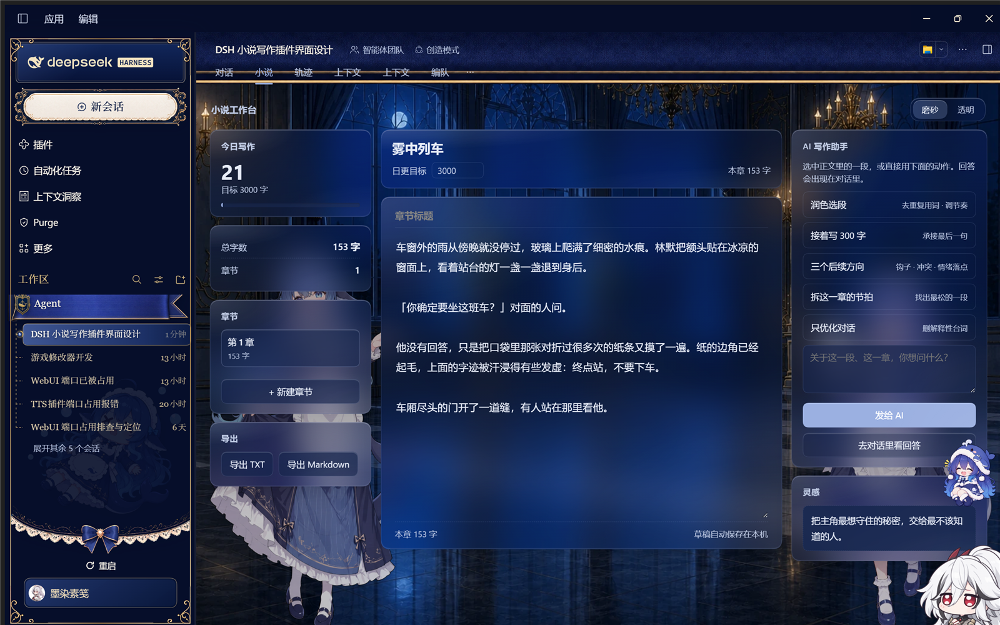

# dsh-novel-studio

A novel-writing workspace for [DeepSeek Harness](https://github.com/deepseek-ai). It adds a **Novel** view tab to every session: three frosted-glass card columns, live word counts, chapter cards, and selection-to-AI actions — polish, continue, three story directions, or ask anything about the passage you selected.



## Install

```bash
dsh plugin add dsh-novel-studio
```

Or through the market: **Plugins → Discover → Index sources →** add `https://cdn.jsdelivr.net/npm/dsh-plugin-catalog/index.json` and search for `novel studio`.

Reload the page (or restart the desktop app) and the **Novel** tab appears next to the chat tab.

## What you get

| Column | Contents |
| --- | --- |
| Left | Today's word count vs. daily goal, total count, chapter count, chapter list, export TXT / Markdown |
| Middle | Work title, goal, chapter title, editor, live "this chapter" counter in the footer |
| Right | Five AI actions, a question box, a random story-spark card |

**Live counts** — characters with all whitespace stripped; the editor, the left rail and the footer update on every keystroke. "Today" keeps a per-day baseline and resets itself at midnight.

**Selection bar** — select any passage and a bar floats above it:

```
132 selected · Polish · Continue · Directions · Ask
```

The first three fire immediately; **Ask** expands an inline input. With nothing selected, the right rail falls back to the text just before the caret.

**How actions reach the chat** — primarily through the session API (`sessions.using(...).prompt([{type:'text',text}], 'queue')`), so the prompt lands in the current conversation and the model answers there. If that path is unavailable the prompt is placed in the composer instead, with a visible note either way.

**Material** — cards, floating bar, inputs and buttons are semi-transparent frosted glass: `backdrop-filter: blur() saturate() brightness()`, a gradient fill and a specular edge. Every colour comes from host theme tokens (`--dsw-alias-*`), so the plugin follows any theme.

## Data

Drafts live in `localStorage` under `dsh-novel-studio:v1:<sessionId>` — **one manuscript per session**. Saves are debounced at 400 ms and also flush on `pagehide`, `beforeunload` and unmount, so a reload never eats the last few seconds of typing. Export writes TXT or Markdown.

## Compatibility

- Requires dsh `>=0.2.1-rc.1`
- Client-only: no host data access, no network calls, no telemetry

## 中文说明

完整中文说明见 [README.zh.md](./README.zh.md)。

简单说：对话页多一个「小说」标签，三栏卡片写着写着就顺手了——字数实时跳、章节随便切、选中一段就能让 AI 润色/续写/给三个后续方向，或者就着你选的那句话提问。草稿按会话独立存在本机，刷新不丢。

## License

MIT
