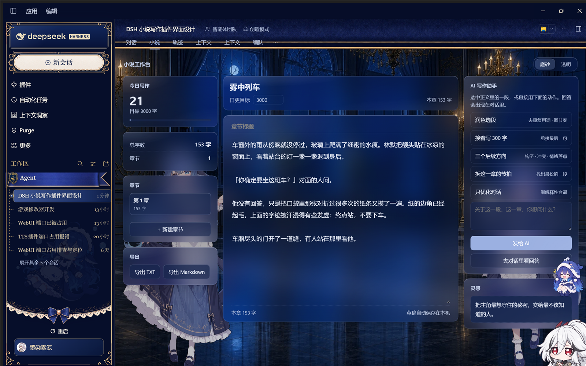

# dsh-novel-studio

给 [DeepSeek Harness](https://github.com/deepseek-ai) 的小说写作工作台。会话里多出一个「小说」标签页：三栏卡片布局、半透明磨砂玻璃材质、实时字数统计，选中正文任意一段就能让 AI 润色、续写、给后续方向或直接提问。



## 装

```bash
dsh plugin add dsh-novel-studio
```

或者用市场：**插件 → 发现 → 索引源** 里添加 `https://cdn.jsdelivr.net/npm/dsh-plugin-catalog/index.json`，搜 `novel studio` 直接装。

装完刷新页面（桌面端重启也行），对话页顶部会多出「小说」标签。

## 有什么

**三栏卡片**

- 左栏：今日写作 / 日更目标进度、总字数、章节数、章节列表、导出 TXT / Markdown
- 中栏：作品标题、日更目标、章节标题、正文编辑器，页脚常驻本章字数
- 右栏：AI 写作助手五个动作 + 提问框 + 灵感卡片

**字数统计**

正文去掉所有空白后的字符数，正文、左栏、页脚三处实时同步；今日写作按天记基准，跨日自动归零重算。

**划词向 AI 提问**

选中任意一段，正文上方浮出操作条：

```
已选 132 字 · 润色 · 续写 · 写作方向 · 提问
```

- 前三个直接发指令
- 「提问」就地展开输入框，写完点发送
- 没选中时，右栏动作默认取光标前最近的一段

发出去的是结构化 prompt，带上作品名、章节名、选段原文和你的问题，并要求模型只给可执行的东西（改法、三个方向、节拍骨架），不要客套。

**动作怎么进对话**

1. 优先通过 Session API（`sessions.using(...).prompt([{type:'text',text}], 'queue')`）直接投进当前会话
2. 不通就回落到输入框，把 prompt 填好等你按回车

两条路都有回执，不会点了没反应。

**材质**

卡片、浮条、输入框、按钮全部是半透明磨砂玻璃：`backdrop-filter: blur() saturate() brightness()` + 渐变底色 + 边缘高光，全部颜色取自宿主主题 token（`--dsw-alias-*`），换主题自动跟着变。想调通透度改 `.ns-card` 里的 `58%/34%`，想调磨砂粗细改 `blur(24px)`。

## 数据存在哪

草稿保存在浏览器 localStorage，键 `dsh-novel-studio:v1:<sessionId>`，**每个会话一份独立稿子**。400ms 防抖保存，另外监听 `pagehide` / `beforeunload` 和卸载时各刷一次，刷新、关窗口都不会丢最后几个字。导出功能可以直接把整部作品落成 TXT 或 Markdown。

## 兼容

- 需要 dsh `>=0.2.1-rc.1`
- 纯 Client 插件，不读写宿主数据、不联网、不发任何上报

## 开发

```bash
git clone https://github.com/tonglingming-hue/dsh-novel-studio.git
```

把仓库目录作为 bundle 装进 profile 后，改 `client.js` 再刷新页面即生效（客户端插件不走 HMR，刷新是必须的）。`node --check client.js` 可以单独验语法。

## License

MIT
